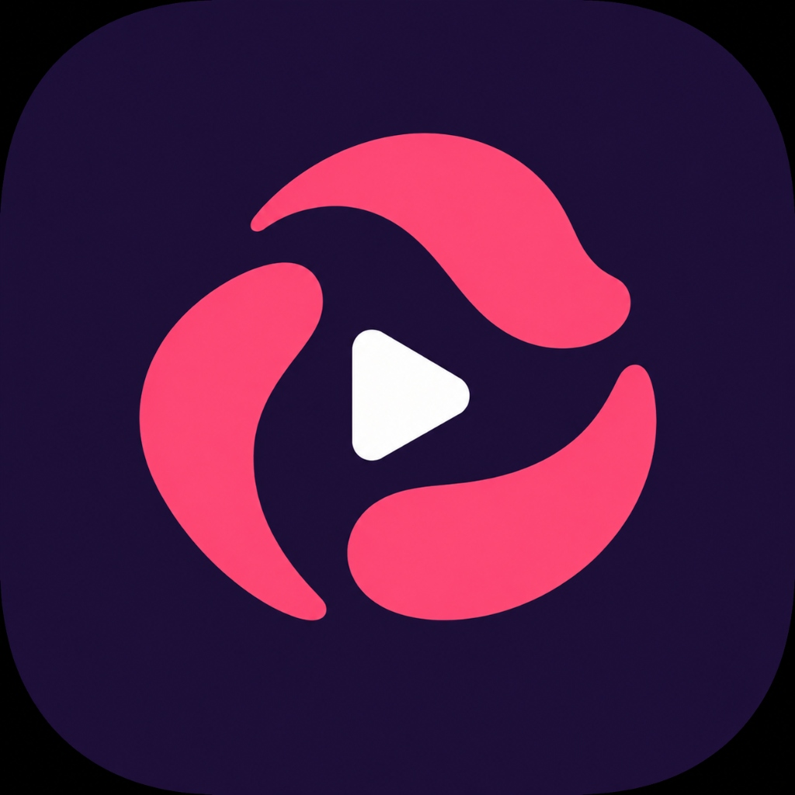
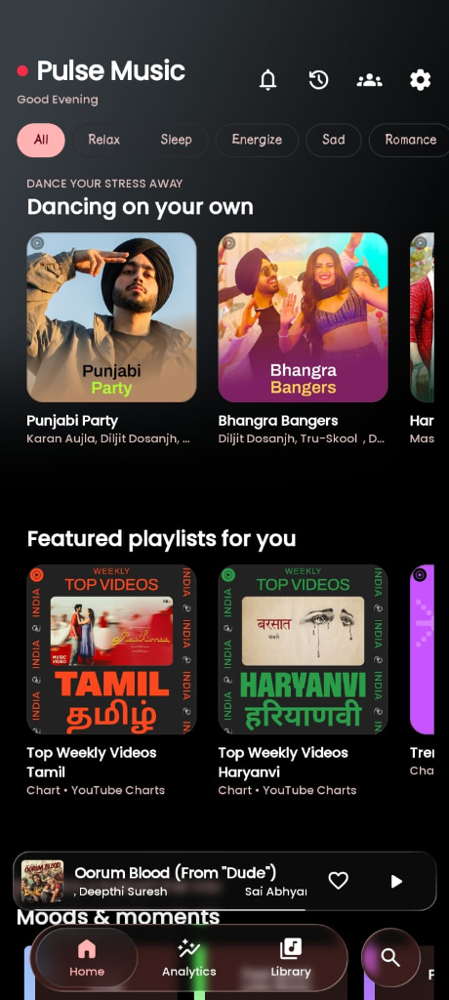
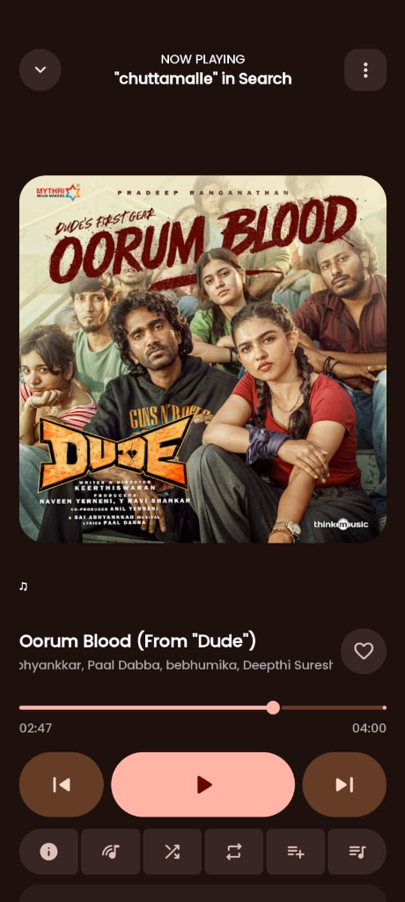
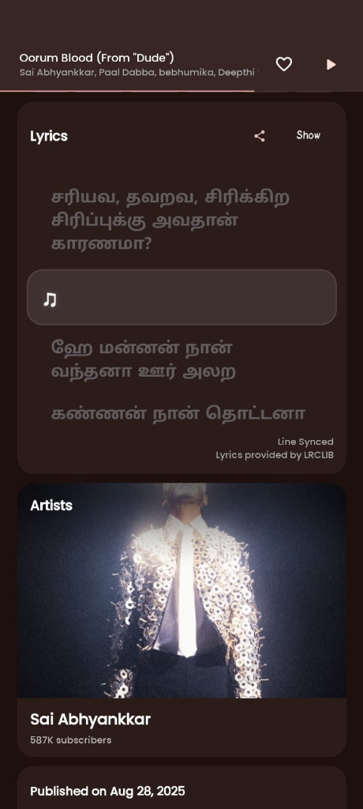
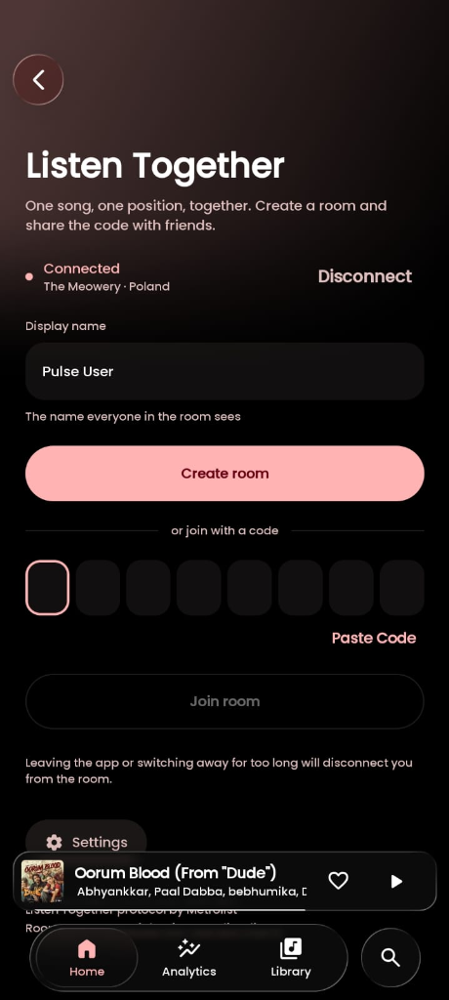
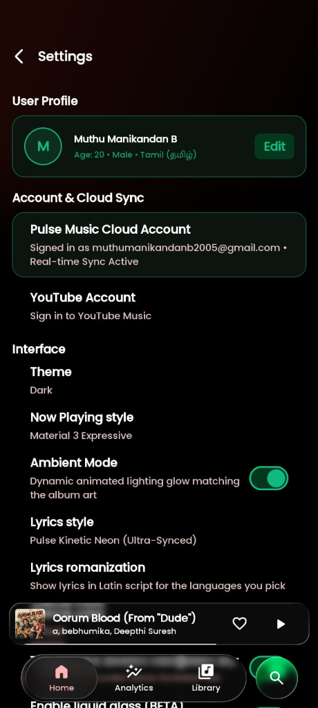

<div align="center">
  
  <h1>Pulse Music</h1>
  <p><strong>Next-Generation Open-Source Music Player & High-Fidelity YouTube Music Streaming App for Android, Windows, Mac, and Web.</strong></p>

  <p>
    <a href="https://github.com/muthumanikandanb2005-ux/PulseMusic/stargazers"></a>
    <a href="https://github.com/muthumanikandanb2005-ux/PulseMusic/releases/latest"></a>
    <a href="https://github.com/muthumanikandanb2005-ux/PulseMusic/releases"></a>
    <a href="https://pulsemusic-75581-main.netlify.app/"></a>
    <a href="https://github.com/muthumanikandanb2005-ux/PulseMusic/blob/main/LICENSE"></a>
    <a href="https://github.com/RookieEnough/Orion-Data/issues/1819"></a>
    <a href="https://github.com/muthumanikandanb2005-ux/PulseMusic#install-via-obtainium"></a>
    <a href="https://apt.izzysoft.de/fdroid/"></a>
    <a href="https://pulse-webplayer.netlify.app/"></a>
    <a href="https://pulsemusic-75581-main.netlify.app/"></a>
  </p>

  <h3>⚡ Instant Downloads & Web Player (v4.1.4 - Build 114)</h3>

| Platform / Architecture | Direct Package Link | Target Devices |
| :--- | :--- | :--- |
| **Official Online Web Player (Instant Streaming)** | [🌐 **pulse-webplayer.netlify.app**](https://pulse-webplayer.netlify.app/) | Any Web Browser, Windows, Mac, Linux, iOS, Android (No Download Needed) |
| **Official App Landing Site** | [📱 **pulsemusic-75581-main.netlify.app**](https://pulsemusic-75581-main.netlify.app/) | App Overview, Screenshots, Features & Release Notes |
| **Android Universal (Recommended)** | [📥 **PulseMusic-Universal.apk**](https://github.com/muthumanikandanb2005-ux/PulseMusic/releases/download/v4.1.4/PulseMusic-Universal.apk) | All Android Phones & Tablets (All ABIs) |
| **Android 64-bit Optimized** | [📥 **PulseMusic-arm64-v8a.apk**](https://github.com/muthumanikandanb2005-ux/PulseMusic/releases/download/v4.1.4/PulseMusic-arm64-v8a.apk) | Modern Android Phones (Pixel, Galaxy, OnePlus, Xiaomi) |
| **Windows 10 / 11 Installer** | [💻 **PulseMusic-Windows-x64-Setup.exe**](https://github.com/muthumanikandanb2005-ux/PulseMusic/releases/download/v4.1.4/PulseMusic-Windows-x64-Setup.exe) | Windows 64-bit Setup Installer |
| **Windows Portable Archive** | [📦 **PulseMusic-Windows-x64-Setup.zip**](https://github.com/muthumanikandanb2005-ux/PulseMusic/releases/download/v4.1.4/PulseMusic-Windows-x64-Setup.zip) | Standalone Portable Windows Version |
| **Android Legacy 32-bit** | [📥 **PulseMusic-armeabi-v7a.apk**](https://github.com/muthumanikandanb2005-ux/PulseMusic/releases/download/v4.1.4/PulseMusic-armeabi-v7a.apk) | Older 32-bit Android Hardware |
| **Android Emulator / Intel / AMD** | [📥 **PulseMusic-x86_64.apk**](https://github.com/muthumanikandanb2005-ux/PulseMusic/releases/download/v4.1.4/PulseMusic-x86_64.apk) | Chromebooks, Windows WSA, Android x86 |

</div>

---

## 🌐 Instant Web Streaming — No App Download Required!

Don't want to install software on your **Windows PC**, **Mac / MacBook**, **Chromebook**, or **iPhone / iPad**? You can stream the complete catalog instantly with zero downloads directly from your browser!

<div align="center">

[](https://pulse-webplayer.netlify.app/)
[](https://pulse-webplayer.netlify.app/)
[](https://pulsemusic-75581-main.netlify.app/)

👉 **[Click Here to Launch Pulse Web Player: https://pulse-webplayer.netlify.app/](https://pulse-webplayer.netlify.app/)**  
*(Or explore the App Overview site at [https://pulsemusic-75581-main.netlify.app/](https://pulsemusic-75581-main.netlify.app/))*

| Platform | Web App Experience (Zero Download) |
| :--- | :--- |
| **💻 Windows Users** | Stream instantly without downloading `.exe` installers or `.zip` files. |
| **🍎 Mac & MacBook Users** | Zero installation needed! Works directly in Safari, Chrome, Edge, and Firefox on macOS. |
| **📱 iPhone & iPad (iOS)** | Open in Safari, tap **Share ➔ Add to Home Screen** for a full PWA native app feel. |
| **🐧 Linux & Chromebooks** | Full high-fidelity streaming in any browser with background playback. |
| **🚫 100% Ad-Free** | Pure ad-free playback, time-synced lyrics, and instant search without logins. |

</div>

---

## 🌟 Why Pulse Music?

Pulse Music is built from the ground up to provide a **flawless, commercial-grade music listening experience** completely free and without ads or tracking. Powered by **Compose Multiplatform** and **Kotlin Multiplatform**, Pulse delivers smooth animations, zero playback buffering freezes, and studio-grade audio processing.

### 🛡️ Listen Healthy & Hearing Protection (WHO 85dB Standard)
- **Automatic Safe Volume Limiter**: Protects your eardrums by safely capping headphone output at 75% (~85dB), conforming to World Health Organization sound safety recommendations.
- **Continuous Exposure Safety Monitor**: Live badge tracker (`SAFE`, `MODERATE`, `BREAK NEEDED`) calculating your listening dosage and intensity in real time.
- **Ear Fatigue Break Reminders**: Set interval reminders (30m, 45m, 60m, 90m, 120m) to pause and rest your hearing during extended sessions.

### 🧭 Intelligent Song Discovery & Smart Radio Mix
- **Discovery Mix Slider**: Balance your personal favorites with fresh global releases. Dial from 0% (Familiar) to 100% (Full Exploration) directly from Settings or Queue.
- **One-Tap Quick Picks Preset**: Instantly switch discovery ratios (20%, 50%, 100%) on the Home screen header for curated musical variety.

### ⚡ Zero-Lock & Anti-Freeze Continuous Playback Engine
- **Non-Blocking Reactive Flows**: Database queries operate asynchronously across all media pipelines, permanently resolving 1+ hour playback lockups and app reopen freezes.
- **Instant Track Skips**: Rapid track transitions without audio buffer starvation, lag, or memory leaks.

### 🎤 Apple Music & Spotify Hybrid Synchronized Lyrics
- **Karaoke Syllable & Grapheme Glow**: Word-by-word and letter-by-letter progressive lyrics highlighting that pulses to the rhythm.
- **Multilingual Romanization**: Native pronunciation romanization for 12+ scripts including Japanese (Hiragana/Katakana/Kanji), Korean (Hangul), Chinese (Pinyin), Tamil, Telugu, Hindi, Malayalam, and Arabic.
- **Mini Floating Capsule Lyrics**: Sleek floating lyrics overlay for uninterrupted multi-tasking.

### 🎨 Visual Splendor & Dynamic Themes
- **Dynamic Ambient Artwork Glow**: Real-time palette extraction matching playback glow to high-res album cover art.
- **Instant Theme Switcher**: Choose between **Dark AMOLED (#000000)**, **Pure Light**, **System Default**, and the luxurious **Pastel Pearl Lavender** theme.

### 🎚️ Audiophile Equalizer & Spatial Audio
- **10-Band Professional Equalizer**: Fine-tune frequency bands with precision.
- **AutoEq Headphone Profiles**: Calibrated equalization for over 1,000+ headphone models.
- **Spatial 8D Audio & Reverb**: Experience panoramic surround sound and acoustic room modeling on any stereo headphones.

### 🚗 Android Auto & Windows Desktop Integration
- **Android Auto**: Full in-vehicle display support for playlists, queue, albums, and voice commands.
- **Windows System Media Controls (SMTC)**: Native media key shortcuts, playback controls in taskbar and lockscreen.

---

## 📊 Feature Matrix: Pulse Music vs Other Players

| Feature | ⚡ Pulse Music (PulseMusic) | 🔴 YouTube Music | 🟢 Spotify | 🔵 ViMusic / RiMusic |
| :--- | :---: | :---: | :---: | :---: |
| **100% Free & Zero Ads** | **✅ Zero Ads Ever** | ❌ Paid Subscription Req. | ❌ Paid Subscription Req. | ✅ Free |
| **Instant Web Player (No Download)** | **✅ [pulse-webplayer.netlify.app](https://pulse-webplayer.netlify.app/)** | ⚠️ Login Required | ⚠️ Login Required | ❌ No Web Player |
| **Audio Quality** | **✅ Master FLAC / High-Res** | ⚠️ 256 kbps AAC | ⚠️ 320 kbps OGG | ⚠️ 160 kbps Opus |
| **Synced Karaoke Lyrics** | **✅ Syllable Glow (LRCLIB)** | ❌ Basic / Partial | ⚠️ Subscription / Delayed | ⚠️ Basic Lines |
| **Pure AMOLED Dark Mode (#000000)** | **✅ Liquid Glass Pure AMOLED** | ❌ Dark Grey | ❌ Dark Grey | ⚠️ Basic Dark |
| **WHO 85dB Hearing Protection** | **✅ Built-in Dosage Safety** | ❌ None | ❌ None | ❌ None |
| **Smart Discovery Mix Slider** | **✅ 0% to 100% Ratio** | ⚠️ Algorithm Locked | ⚠️ Algorithm Locked | ❌ None |
| **Android Auto Support** | **✅ Full Vehicle Interface** | ⚠️ Premium Only | ⚠️ Yes | ⚠️ Limited |
| **Account / Login Required** | **🚫 None (100% Private)** | ❌ Google Login Required | ❌ Spotify Account Req. | 🚫 None |
| **Open Source (GPL-3.0)** | **✅ 100% Open Source** | ❌ Proprietary Closed | ❌ Proprietary Closed | ✅ Open Source |

---

## 📸 Screenshots

<div align="center">
  
  
  
  
  
</div>

---

## 🚀 App Stores & OTA Distribution Channels

### 1. Orion Store (Official Verified Package)
Pulse Music is officially registered and verified in the **Orion Store**:
- **Store Issue**: [#1819 - Pulse Music](https://github.com/RookieEnough/Orion-Data/issues/1819)
- **Package ID**: `com.pulse.music`
- **Updates**: Orion Store automatically updates Pulse Music via GitHub release broadcasts.

### 2. Install via Obtainium (1-Click Auto Updates)
1. Install [Obtainium](https://github.com/ImranR98/Obtainium) on your Android device.
2. Tap **Add App** and paste: `https://github.com/muthumanikandanb2005-ux/PulseMusic`
3. Filter APK: `PulseMusic-Universal.apk` (or import [obtainium.json](obtainium.json)).
4. Tap **Save** & **Install** — Obtainium notifies and updates Pulse Music directly on every GitHub release.

### 3. In-App Background OTA Engine
Pulse Music features built-in update checkers on both Android and Windows:
- Auto-checks [`version.json`](https://raw.githubusercontent.com/muthumanikandanb2005-ux/PulseMusic/main/version.json) on startup.
- Displays an interactive download & install banner with changelog details.

---

## 👨‍💻 Creator & Sole Lead Developer

<div align="center">
  <h3><a href="https://github.com/muthumanikandanb2005-ux">Muthumanikandan B</a></h3>
  <p><strong>Owner, Creator & Sole Lead Developer</strong></p>
  <p><em>Owned and developed by Manikandan</em></p>
  <p>
    <a href="https://github.com/muthumanikandanb2005-ux"></a>
    <a href="mailto:muthumanikandanb2005@gmail.com"></a>
  </p>
</div>

---

## 💖 Support the Developer (Donate via UPI)

If you love **Pulse Music** and want to support active development, zero-ad streaming, and continuous improvements, consider donating directly via **UPI**! Every contribution directly supports independent open-source audio engineering.

<div align="center">

[](upi://pay?pa=muthu.b@superyes&pn=Muthumanikandan%20B&cu=INR&tn=Pulse%20Music%20Support)

| Payment Detail | Information |
| :--- | :--- |
| **UPI ID / VPA** | `muthu.b@superyes` |
| **Recipient Name** | **Muthumanikandan B** (Pulse Music) |
| **Accepted Apps** | **Google Pay** (GPay), **PhonePe**, **Paytm**, **BHIM**, **Super.money**, **Amazon Pay**, **Cred**, Any Banking UPI App |

<br/>

<a href="upi://pay?pa=muthu.b@superyes&pn=Muthumanikandan%20B&cu=INR&tn=Pulse%20Music%20Support">
  
</a>

<p><em>📱 Tap the button on mobile or scan the QR code with any UPI app to donate</em></p>

</div>

---

## 🌟 Boost Visibility & Support the Project

Pulse Music is an independent, community-driven open-source project. If you find this project valuable, here are the easiest ways to help grow our community:

1. **Star this repository ⭐**: Click the star button at the top right to boost our ranking on GitHub trending and discoverability!
2. **Share Pulse Music**:
   - [📢 **Share on Reddit**](https://www.reddit.com/submit?title=Pulse%20Music%20(PulseMusic)%20-%20Free%2C%20Ad-Free%20Music%20Streaming%20App%20and%20Web%20Player%20for%20Android%2C%20Windows%2C%20and%20Web&url=https%3A%2F%2Fgithub.com%2Fmuthumanikandanb2005-ux%2FPulseMusic) (Post to r/androidapps, r/fossdroid, r/opensource, r/freemediaheckyeah)
   - [🐦 **Share on Twitter / X**](https://twitter.com/intent/tweet?text=Check%20out%20Pulse%20Music%20(PulseMusic)%20-%20an%20ad-free%20open-source%20music%20streaming%20player%20and%20instant%20web%20player%20with%20synced%20lyrics%20and%20lossless%20audio!%20https%3A%2F%2Fgithub.com%2Fmuthumanikandanb2005-ux%2FPulseMusic)
   - [✈️ **Share on Telegram**](https://t.me/share/url?url=https%3A%2F%2Fgithub.com%2Fmuthumanikandanb2005-ux%2FPulseMusic&text=Pulse%20Music%20(PulseMusic)%20-%20Free%20Ad-Free%20Music%20Streaming%20Player)
   - [💬 **Share on WhatsApp**](https://api.whatsapp.com/send?text=Check%20out%20Pulse%20Music%20(PulseMusic)%20-%20Ad-free%20music%20streaming%20and%20instant%20web%20player:%20https%3A%2F%2Fpulse-webplayer.netlify.app%2F)
3. **Embed the Pulse Music Badge in your projects**:
   ```markdown
   [](https://pulse-webplayer.netlify.app/)
   ```

---

## 🔍 Search & Discoverability Tags

`pulsemusic` • `pulse music` • `pulse-music` • `pulse web player` • `pulse webplayer` • `pulse music apk` • `pulse music app` • `pulse music download` • `youtube music client android` • `ad-free music streaming` • `flac music player` • `open source audio player` • `compose multiplatform music` • `android auto music player` • `lrclib synced lyrics` • `spotify alternative` • `youtube music alternative` • `hearing protection music app`

---

## 🛠️ Building From Source

```bash
# Clone the repository
git clone https://github.com/muthumanikandanb2005-ux/PulseMusic.git
cd PulseMusic

# Build signed Android Universal APK
./gradlew :androidApp:assembleRelease

# Build & Run Windows Desktop app
./gradlew :desktopApp:run
```

---

## 👥 Author & Maintainer

<div align="center">

| Name | Role | Profile |
| :---: | :---: | :---: |
| [**Manikandan** (*muthumanikandanb2005-ux*)](https://github.com/muthumanikandanb2005-ux) | **Sole Creator, Author & Lead Developer** | [GitHub Profile](https://github.com/muthumanikandanb2005-ux) |

<br/>

**Pulse Music is exclusively created, maintained, and developed by a single author: Manikandan.**

</div>

---

## 📄 License & Integrity Protection

Pulse Music is proprietary software owned and developed exclusively by **Manikandan**. Source code is locked with active anti-tamper and decompiler integrity protection (`PrivateAppIntegrityLock`). See the [LICENSE](LICENSE) file for complete terms.

- **Package Namespace**: `com.pulse.music`
- **Official Repository**: [https://github.com/muthumanikandanb2005-ux/PulseMusic](https://github.com/muthumanikandanb2005-ux/PulseMusic)
- **Copyright**: © 2026 Pulse Music. Owned and developed by Manikandan.
